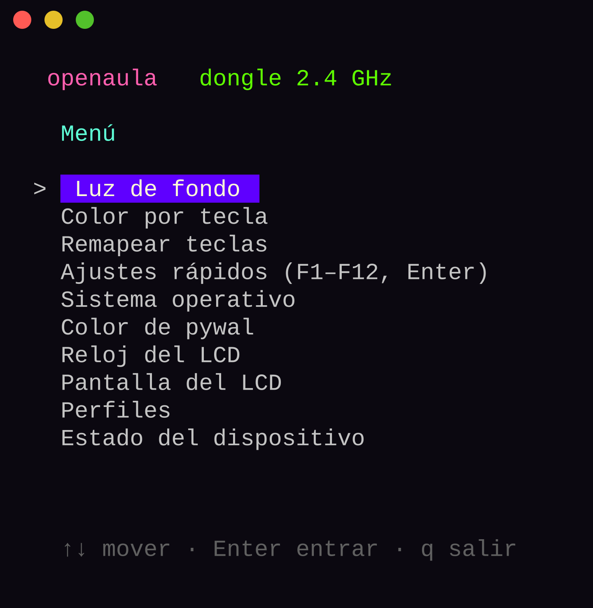
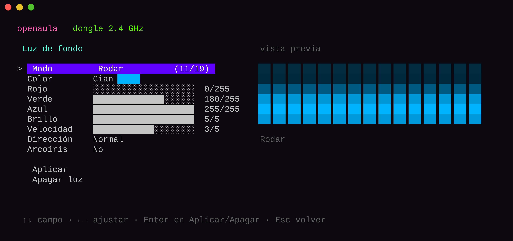
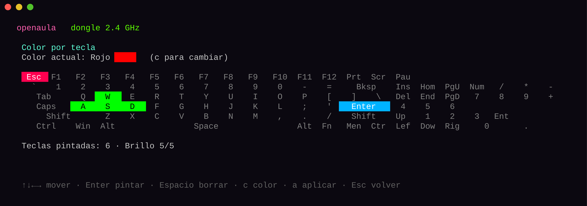
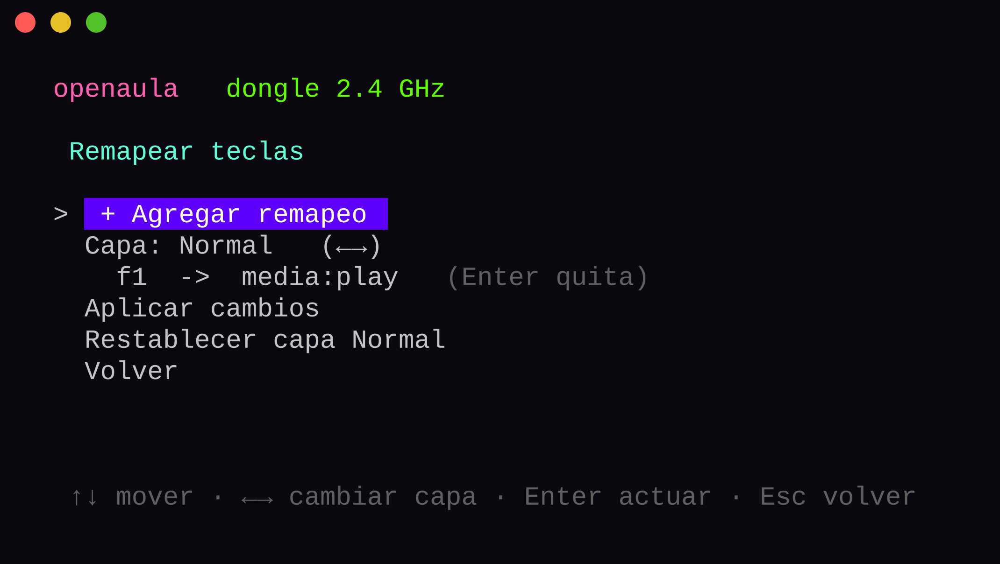
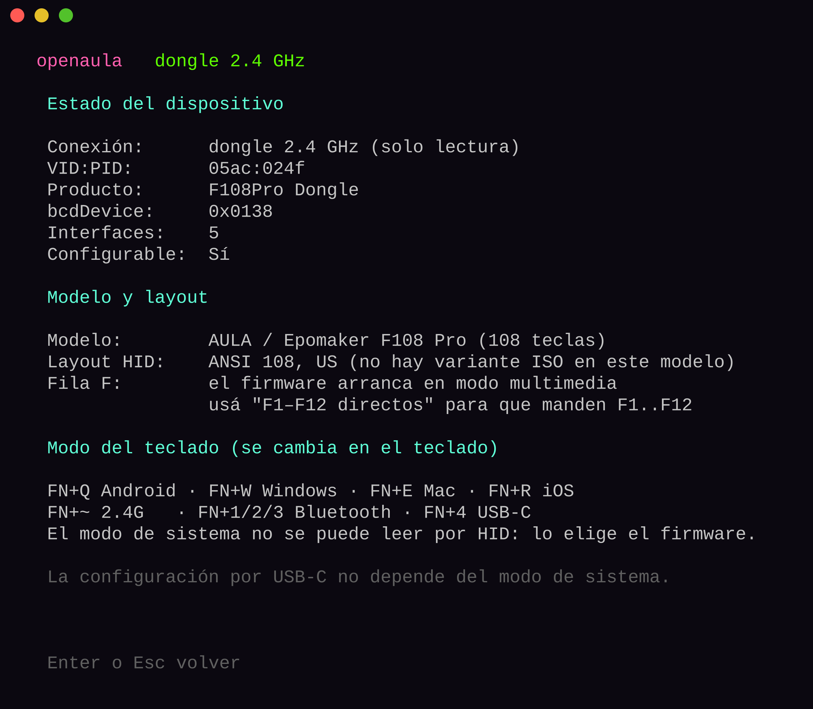

# openaula

Configuración del teclado **AULA / Epomaker F108 Pro** en Linux, sin depender
del software de Windows.

Un solo binario estático en Go con tres formas de uso:

- **TUI** (por defecto): menús con flechas y Enter.
- **CLI**: un comando por acción, para scripts.
- **API HTTP/JSON** local, opcional y con apagado por inactividad.

No hay proceso residente: cada acción abre el teclado, manda el comando y sale.
Cuando no hay nada corriendo, openaula no consume CPU, memoria ni USB.

> **Recomendado: configurar por cable USB-C.** Es el camino más rápido y
> confiable. La configuración por 2.4 GHz **también funciona y está probada**
> (luz, color por tecla, remapeos, reloj y batería), con una sola excepción:
> **subir imágenes al LCD por 2.4 GHz es problemático** porque la transferencia
> es larga y el teclado se suspende a mitad de camino. Para imágenes, usá el
> cable.
>
> **Probado únicamente en el AULA F108 Pro ANSI de 108 teclas con firmware
> `0x0138`.** No se probó en otros modelos, en la variante ISO, en los rebrand
> de AJAZZ/Epomaker/Alma ni en otras versiones de firmware. Si tu teclado tiene
> otro VID/PID, openaula no lo va a detectar. Ver
> [Compatibilidad](#compatibilidad).

---

## Funciones

- **Luz de fondo**: los 20 efectos del firmware, color RGB, brillo (0-5),
  velocidad (0-5) y dirección.
- **Color por tecla**: editor sobre la disposición ANSI de 108 teclas, con
  paleta y brillo propio.
- **Remapeo de teclas**: capa normal y capa FN. Teclas, multimedia, mouse y
  combinaciones (`ctrl+c`, `win+d`), con búsqueda por nombre.
- **Ajustes rápidos**: `F1–F12 directos` (sin apretar Fn) y `Restaurar Enter`.
- **Perfiles de sistema**: Windows/Linux, macOS, iPadOS/iOS, Android y neutral,
  con compensación de modificadores.
- **Color de pywal/wallust**: aplicar el acento del escritorio, siguiendo los
  cambios de paleta si activás la opción.
- **Reloj del LCD** y **subida de imágenes** (GIF animado, PNG o JPEG).
- **Perfiles**: guardar y aplicar configuraciones completas.
- **Batería y firmware**: nivel de batería por 2.4 GHz y versión desde
  `bcdDevice`.

## Capturas

Los prints salen de la propia TUI con datos de demostración (`tools/shots`).

**Menú principal**



**Luz de fondo, con vista previa animada del efecto**



**Color por tecla**



**Remapeo de teclas**



**Estado del dispositivo**



---

## Hardware

| Dato | Valor |
| --- | --- |
| Modelo | AULA F108 Pro (三模机械键盘) |
| Fabricante | Dongguan Suoai Electronic Technology |
| Teclas | 108, ANSI US, sin variante ISO conocida |
| Conexiones | USB-C, 2.4 GHz (dongle), Bluetooth |
| MCU | Sonix SN32F290, Cortex-M0, 256 KB de flash |
| Almacenamiento | SPI flash de 16 MB solo con gráficos |
| Pantalla | LCD 240x135, RGB565, hasta 141 cuadros |
| Firmware de referencia | `0x0138` (138) |
| VID:PID cable | `0c45:800a` |
| VID:PID dongle | `05ac:024f` (el dongle imita un teclado Apple) |
| Batería | reportada por 2.4 GHz |

Otras variantes que aparecen en el ecosistema AULA/Epomaker/AJAZZ/Alma comparten
software de Windows, pero **no están verificadas acá**. Si tu unidad responde,
abrí un issue con el `bcdDevice` y el VID:PID.

---

## Estado del soporte

| Función | USB-C (`0c45:800a`) | Dongle 2.4 GHz (`05ac:024f`) |
| --- | --- | --- |
| Detección y batería | sí | sí |
| Luz de fondo | sí | sí (probado) |
| Color por tecla | sí | sí (probado) |
| Remapeo | sí | sí (probado) |
| Reloj del LCD | sí | sí (probado) |
| Imagen en el LCD | sí | experimental: se corta si el teclado se duerme |

Cuando están los dos conectados se usa el cable. **Bluetooth no permite
configuración**, igual que en el software oficial de Aula.

La configuración se aplica al firmware del teclado: podés configurar por cable
y después usar 2.4 GHz o Bluetooth con los mismos ajustes.

---

## Instalación

### Cualquier distribución (binario estático)

```sh
curl -fsSL https://raw.githubusercontent.com/ldgnu/openaula/main/install.sh | sh
```

El instalador:

- detecta la arquitectura (x86_64, aarch64, armv7, i386),
- baja el binario del último release o compila si no hay build,
- lo instala en `/usr/local/bin` (o `~/.local/bin` sin root),
- escribe la regla udev con el grupo que exista (`usb`, `plugdev` o `input`),
- avisa si tu usuario tiene que sumarse a ese grupo.

Variables: `VERSION`, `PREFIX`, `FROM_SOURCE=1`, `NO_SUDO=1`.

### Arch Linux (AUR)

```sh
# compilando desde fuente
yay -S openaula

# o el binario del release
yay -S openaula-bin
```

Los `PKGBUILD` están en `packaging/aur/`.

### Gentoo

Overlay local o GURU, según `docs/EMPAQUETADO.md`. La vía rápida es el binario:

```sh
curl -fsSL https://raw.githubusercontent.com/ldgnu/openaula/main/install.sh | sh
```

### Desde el código

Solo hace falta Go. No hay cgo ni libusb.

```bash
make build          # ./openaula
sudo make install   # /usr/local/bin
sudo make udev      # regla udev
```

---

## Uso

```bash
openaula            # TUI
openaula status     # estado del dispositivo
openaula help       # lista completa
```

### TUI

Flechas para mover, izquierda/derecha para cambiar un valor, Enter para actuar,
Esc para volver. Cada pantalla muestra sus teclas abajo, sin atajos ocultos.

| Pantalla | Qué hace |
| --- | --- |
| Luz de fondo | Modo, color, brillo, velocidad, dirección, aplicar, apagar |
| Color por tecla | Grilla de 108 teclas, Enter pinta, Espacio borra, `c` color, `a` aplica |
| Remapear teclas | Capa normal o FN, origen y destino con búsqueda |
| Ajustes rápidos | F1–F12 directos, restaurar Enter |
| Sistema operativo | Windows/Linux, macOS, iPadOS/iOS, Android, neutral |
| Color de pywal | Elegir acento, activar el seguimiento automático |
| Reloj del LCD | Sincronizar con la hora del sistema |
| Pantalla del LCD | Color sólido, subir imagen, reloj |
| Perfiles | Guardar, aplicar y borrar configuraciones |
| Estado | Conexión, VID:PID, firmware, batería, interfaces |

### CLI

```bash
openaula light --mode 1 --color 255,0,0 --brightness 5   # rojo estático
openaula light --mode 7 --color 0,0,255 --speed 3       # respirar azul
openaula light --mode 6 --colorful                      # arcoíris
openaula off                                            # apagar
openaula preset fkeys                                   # F1..F12 sin Fn
openaula preset enter                                   # restaurar Intro
openaula preset --list                                  # ver presets
openaula os macos                                       # modificadores para macOS
openaula os                                             # perfil actual
openaula perkey --all 0,0,40 w=0,255,0 a=0,255,0        # WASD verde
openaula perkey --apply                                 # reaplicar lo guardado
openaula remap capslock=lctrl f1=media:play             # capa normal
openaula remap --layer fn f1=media:volup                # capa FN
openaula remap --reset                                  # borrar remapeos
openaula clock                                          # reloj del LCD
openaula lcd color 255,0,0                              # LCD rojo
openaula lcd image logo.gif --yes                        # GIF, PNG o JPEG
openaula lcd image logo.gif --yes --start 14346          # reanudar subida
openaula wal --index 4                                  # color de pywal
openaula wal --watch                                    # seguir cambios
openaula battery                                        # batería (2.4 GHz)
openaula keys                                           # nombres de teclas
openaula modes                                          # modos de luz
```

### API

Opt-in, y se apaga sola si la configurás con `--idle`:

```bash
openaula serve --addr 127.0.0.1:8723 --idle 60s
```

```bash
curl -s localhost:8723/api/v1/status
curl -s -X POST localhost:8723/api/v1/light \
  -d '{"mode":1,"r":255,"g":0,"b":0,"brightness":5}'
curl -s -X POST localhost:8723/api/v1/perkey \
  -d '{"brightness":5,"colors":{"w":[0,255,0],"a":[0,255,0]}}'
curl -s -X POST localhost:8723/api/v1/presets/fkeys
curl -s -X POST localhost:8723/api/v1/os/macos
curl -s -X POST localhost:8723/api/v1/clock
curl -s -X POST localhost:8723/api/v1/wal -d '{"index":4}'
curl -s -X POST -F file=@logo.png -F confirm=true localhost:8723/api/v1/lcd/image
curl -s localhost:8723/api/v1/profiles
curl -s -X POST localhost:8723/api/v1/profiles/noche/apply
```

| Método | Ruta | Uso |
| --- | --- | --- |
| GET | `/api/v1/status` | dispositivo, firmware, batería y configuración guardada |
| GET | `/api/v1/modes` | modos de luz y qué parámetros acepta cada uno |
| GET | `/api/v1/keys` | teclas con fila, columna y ancho |
| GET/PUT | `/api/v1/state` | configuración deseada |
| POST | `/api/v1/light` | luz de fondo |
| POST | `/api/v1/off` | apagar luz |
| POST | `/api/v1/perkey` | color por tecla |
| POST | `/api/v1/remap` | remapeos (`layer` normal o fn) |
| POST | `/api/v1/remap/reset?layer=fn` | borrar capa |
| POST | `/api/v1/presets/{id}` | preset de remapeo |
| POST | `/api/v1/os/{id}` | perfil de sistema |
| POST | `/api/v1/clock` | sincronizar reloj |
| POST | `/api/v1/lcd/color` | color sólido |
| POST | `/api/v1/lcd/image` | imagen (multipart, `confirm=true`) |
| GET/POST | `/api/v1/wal` | paleta de pywal y aplicar acento |
| GET/POST/DELETE | `/api/v1/profiles[/{name}]` | perfiles |
| GET | `/api/v1/health` | vida del server |

---

## Destellos por eventos

Dos comandos para reaccionar a eventos del sistema. Ambos son opt-in: si no los
corrés, no hay nada de fondo.

```bash
# Destello puntual, para usar desde cualquier hook
openaula flash --color 0,255,0 --duration 200ms

# Vigilar notificaciones y volumen
openaula watch --notifications --volume
```

`watch` escucha:

- **Notificaciones**: llamadas a `org.freedesktop.Notifications.Notify` por
  D-Bus. Destella en blanco (configurable con `--color`).
- **Volumen**: cambios en el sink por defecto vía `pactl subscribe`, con
  `wpctl` o `pactl` para leer el nivel. Verde al subir (`--vol-up`) y rojo al
  bajar (`--vol-down`).

Después del destello vuelve a la configuración guardada. Los eventos seguidos se
agrupan con un debounce de 120 ms.

Para dejarlo permanente hay una unidad de usuario:
`packaging/systemd/openaula-watch.service`.

Alternativa sin daemon: engancharlo al gestor de notificaciones.

```ini
# dunst: ~/.config/dunst/dunstrc
[urgency_normal]
    script = openaula flash --color 255,255,255 --duration 150ms
```

---

## Configuración persistente

El teclado **no se puede leer**: el protocolo es write-only. openaula guarda lo
último aplicado en:

```
~/.config/openaula/state.json      # configuración deseada
~/.config/openaula/profiles/*.json # perfiles
```

Ese archivo es la fuente de verdad. Si aplicás algo desde otra herramienta, el
estado local queda desactualizado; reaplicá desde openaula para sincronizar.

---

## F1–F12 sin Fn

El firmware arranca con la fila F en modo multimedia: F1..F12 mandan
volumen/play/etc. y las teclas de función quedan detrás de Fn.

`openaula preset fkeys` remapea la capa normal para que F1..F12 manden sus
códigos HID reales. Los atajos multimedia siguen disponibles en Fn+F1..F12.

Si además querés multimedia en la capa FN sin perder nada, se puede remapear esa
capa aparte:

```bash
openaula remap --layer fn f1=media:volup f2=media:voldown f3=media:mute
```

## Si Intro no responde

`openaula preset enter` fuerza Enter (HID `0x28`) en la capa normal. Si tampoco
así responde, el problema es firmware o switch, no remapeo.

Ojo: el Enter del teclado numérico manda otra secuencia en algunos terminales y
hay aplicaciones que solo escuchan el Enter principal. La TUI de openaula acepta
las dos.

---

## Color de pywal

La opción lee la paleta de:

- `~/.cache/wal/colors.json` (pywal)
- `~/.cache/wallust/colors.json` (wallust)
- `~/.cache/wal/colors` (formato plano)

En la TUI, la fila `Seguir color de pywal al iniciar` activa la opción. Con la
opción activa, al abrir openaula aplica el acento y revisa cada 5 segundos si la
paleta cambió. Desactivada, no hay ningún chequeo.

Por CLI: `openaula wal --follow`, y `openaula wal --watch` para dejarlo
siguiendo en segundo plano.

---

## Pantalla del LCD

- Resolución 240x135, color RGB565.
- Acepta GIF animado, PNG y JPEG. Las imágenes estáticas se escalan manteniendo
  proporción y se centran sobre fondo negro.
- Límite seguro: **141 cuadros**. openaula bloquea anything más grande.
- Cada cuadro pesa ~64 KB. Por 2.4 GHz la subida tarda unos 11 segundos por
  cuadro y el enlace se corta cuando el teclado entra en suspensión, así que
  hay que mantenerlo despierto o reanudar con `--start`. **Para imágenes se
  recomienda el cable USB-C**, que sube en segundos y no depende del timer de
  suspensión.
- Si una subida se corta, `--start N` retoma desde el chunk indicado.

**Advertencia**: subir imágenes puede dañar de forma permanente los gráficos
internos del menú del teclado. Los colores sólidos son la opción segura, y el
límite de cuadros existe por eso.

Generador de animaciones incluido:

```bash
go run ./tools/lcdgen -logo logo.png -out out.gif \
  -tag LDGNU -sub "Lawless Disorder" \
  -line1 "if it moves," -line2 "compile it" \
  -frames 8 -delay 750
```

---

## Compatibilidad

| Teclado | Estado |
| --- | --- |
| AULA F108 Pro ANSI, firmware 138 | probado en hardware |
| AULA F108 Pro con otro firmware | no probado |
| Variantes ISO / 87 teclas / TKL | no soportadas (otro layout y otras tablas) |
| AJAZZ / Epomaker / Alma con la misma placa | no probado |
| Otros teclados con Sonix | no soportados |

La detección es por VID/PID exactos. openaula no intenta adivinar modelos.

## Limitaciones conocidas

- **No se puede leer** la configuración actual: luz, colores, remapeos ni
  versión de firmware no son consultables. El firmware se deduce de `bcdDevice`
  (`0x0138` → `138`).
- **El modo de sistema** (Windows/Mac/iOS/Android) lo decide el firmware con
  FN+Q/W/E/R. Los perfiles de openaula compensan modificadores por remapeo.
- **La barra de luz y las tiras laterales** solo se manejan con combos FN; el
  firmware acepta comandos pero no los aplica.
- **El teclado se suspende**: durante una subida larga por 2.4 GHz deja de
  responder al canal vendor. Los reintentos esperan hasta ~5 minutos, pero si
  no hay actividad de teclas conviene subir por cable.
- **El dongle no tolera paquetes mal formados**: el protocolo 2.4 GHz lleva
  checksum en el byte 31. Mandar paquetes sin checksum puede colgar el receptor
  hasta desconectarlo.

---

## Desarrollo

```
cmd/openaula        CLI y entrada principal
internal/aula       protocolo HID: cable (feature reports) y dongle (32 bytes)
internal/hidraw     acceso a /dev/hidraw
internal/device     operaciones de alto nivel, presets y perfiles de sistema
internal/state      configuración persistente y perfiles
internal/api        servidor HTTP/JSON
internal/tui        interfaz de terminal
internal/wal        lectura de paletas de pywal/wallust
tools/lcdgen        generador de animaciones para el LCD
packaging/          udev, systemd, AUR y Gentoo
docs/PROTOCOLO.md   protocolo documentado
```

```bash
make build
make test
make vet
```

El protocolo está documentado en `docs/PROTOCOLO.md`. El proyecto tiene tests
del framing, del checksum y del generador de imágenes.

---

## Créditos y licencia

El camino cableado fue reversado por Parsia
([parsiya/f108-pro](https://github.com/parsiya/f108-pro), MIT). El camino
2.4 GHz está documentado por kidush
([omarchy-aula-f108pro](https://github.com/kidush/omarchy-aula-f108pro), MIT) a
partir del driver oficial.

Licencia MIT. Ver `LICENSE` y `NOTICE.md`.
